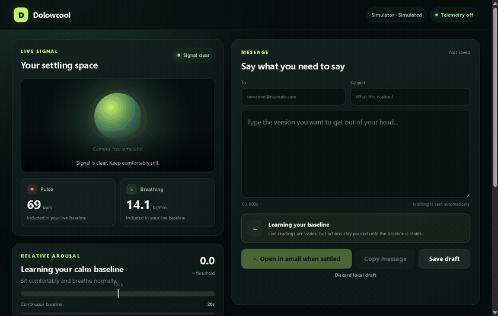
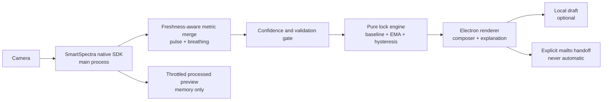
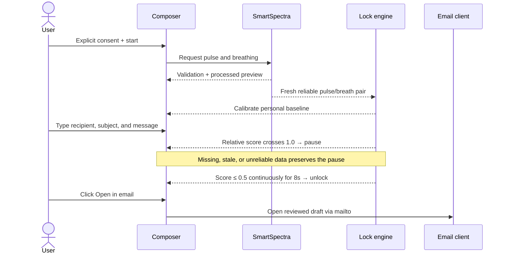

# Dolowcool — a missing body signal can never be mistaken for calm

**Write now. Send when settled.** Dolowcool is an Electron message composer in which live SmartSpectra pulse and breathing readings create a transparent, reversible pause before an email handoff.

[](https://github.com/Agozie180/dolowcool/actions/workflows/ci.yml)


| Judge link | Destination | Status |
| --- | --- | --- |
| Challenge | [Presage SmartSpectra SDK Challenge](https://dev.to/challenges/presage-2026-11-04) | Live |
| Source | [github.com/Agozie180/dolowcool](https://github.com/Agozie180/dolowcool) | Must be made public before submission |
| Demo video | Public live-camera video | Pending owner recording/upload |
| DEV submission | [Draft](docs/devto-post.md) | Pending publication |
| Evidence | [Live test report](LIVE_TEST_REPORT.md) · [Self-audit](AUDIT.md) | Reproducible |
| Pitch deck / litepaper | README + DEV post are the judge packet | Not required by this challenge |

**Event:** Presage SmartSpectra SDK Challenge · **$3,000 total** · ten **$300** winners.

**Category targets:** **Most Creative or Delightful Use** and **Best Thoughtful Real-World Use**. A submission may qualify for both and the overall awards, but can win only once.

| Judging criterion | Dolowcool's protected scoring feature |
| --- | --- |
| Use of underlying technology | Real native SmartSpectra capture; pulse and breathing jointly control the core interaction |
| Usability and UX | Consent-first framing, actionable quality coaching, explainable pause, continuous recovery, and deliberate override |
| Originality and creativity | Body-relative signals become a reversible message-handoff state rather than another readings dashboard |

> **Load-bearing thesis:** A missing, stale, or unreliable body signal can never be interpreted as calm, and Dolowcool never sends automatically.

The novel interaction is not another vital-sign dashboard. SmartSpectra's live measurements control whether message handoff is available, while the user can keep writing, save locally, inspect the exact rule, stop sensing, or deliberately override. The result is a pause the user can understand and reverse—not an emotion detector or a medical verdict.



The GIF is captured from the real Electron UI in the permanently labeled simulator. It contains no face, camera frames, API key, or readings from a person. **Competition evidence must use the live SmartSpectra camera source.**

## What we built

Dolowcool is for anyone who wants a moment between composing a charged message and moving it into an email client. It learns a stable baseline from that session, compares both pulse and breathing rate with that personal baseline, pauses handoff on a relative rise, and restores the choice only after an eight-second continuous settled hold.

The idea came from a familiar failure mode: regretting a message after the body had already signaled that it was not a good moment to send. Dolowcool makes that moment visible without claiming to know why the readings changed.

## How it works





SmartSpectra can emit pulse and breathing in separate packets. Dolowcool retains each latest reliable measurement for at most eight seconds and combines only fresh values. That removes false “missing metric” oscillation without allowing stale readings to unlock the composer.

## The thesis, enforced—not asserted

| Guarantee | Enforcement | Proof |
| --- | --- | --- |
| Missing data is never calm | Either absent metric calls `interrupt()` | `npm test` missing-metric regression |
| Stale data is never calm | Pair cache expires after 8 seconds; lock engine rejects >2.5-second sample gaps | Unit tests + live source implementation |
| Low confidence is never calm | Pulse confidence must be ≥40 and breathing confidence ≥45 | Presage validation tests + strict live run |
| A single low reading cannot unlock | Separate 1.0 lock / 0.5 unlock thresholds plus an 8-second continuous hold | Hysteresis and hold tests |
| Camera trouble cannot fail open | SDK validation loss resets calibration or calm hold and disables actions | Electron smoke tests |
| Dolowcool never sends automatically | The only external action is a user-clicked `mailto:` handoff; override requires a 3-second hold | Email-handoff and hold-gate tests |

## What is used—and deliberately not used

| Surface | Decision | Evidence or reason |
| --- | --- | --- |
| SmartSpectra native Node camera | **Used deeply** | Native 1280×720/30 capture owns the hot path and avoids renderer IPC frame-copy failure |
| `PULSE_RATE` | **Used** | Personal baseline, confidence gate, relative score |
| `BREATHING_RATE` | **Used** | Personal baseline, confidence gate, relative score |
| SDK validation states | **Used** | No face, framing, lighting, motion, and frame-rate states become actionable UI guidance |
| Processed preview | **Used** | Throttled, memory-only preview helps frame face and upper chest |
| SmartSpectra telemetry | **Off by default** | Explicit `enableTelemetry: false`; opt-in only with `DOLOWCOOL_TELEMETRY=1` |
| HRV and facial expression | **Not requested** | They are unnecessary for the thesis and would widen the privacy/interpretation surface |
| Optional AI service | **Not used** | No rewrite model, emotion inference, or third-party message processing |
| Gmail/Outlook API | **Not used** | `mailto:` keeps authentication and automatic sending out of scope |
| Simulator | **Developer fallback only** | Exercises the same UI and lock engine, but is visibly labeled and is never presented as live proof |

## Live experience

Requirements:

- Node.js 22.12 or newer (required by the pinned Electron toolchain)
- Windows x64, macOS Apple Silicon, or Linux x64/ARM64; Linux needs glibc 2.35+
- A SmartSpectra API key
- A camera view containing the face, shoulders, and upper chest with soft front lighting

```bash
npm install
npm test
npm start
```

PowerShell:

```powershell
$env:SMARTSPECTRA_API_KEY='your_key'
npm start
```

Or copy `.env.example` to the ignored `.env` file. The API key remains in Electron's main process and is never exposed to the renderer. Set `DOLOWCOOL_CAMERA_ID` only to select a non-default camera.

Experience flow:

1. Explicitly consent before the camera starts.
2. Keep writing while the preview and live metrics remain visible.
3. Wait for both signals to become reliable and for the stable personal baseline to complete.
4. Inspect **Why is this paused?** if the relative score crosses the threshold.
5. Wait for the continuous settled hold, save the draft, or use the disclosed three-second override.
6. Review the draft in the default email app. Dolowcool never sends it.
7. End the session to release the camera and view a memory-only recap.

## Try the UX without a camera

```bash
npm install
npm run start:sim
```

Press **Run demo scenario** for a permanently labeled, approximately 60-second tour. This proves UI behavior—not live SDK behavior.

Judge path: consent, press **Run demo scenario**, type a fictional recipient/subject/message, open **Why is this paused?**, watch the continuous recovery hold, then stop the session to see the memory-only recap.

## Measured evidence

| Claim | Measured result | Reproduce |
| --- | --- | --- |
| Core behavior | 16 automated unit tests pass | `npm test` |
| Imported unit scope | 73.79% lines, 83.11% branches, 91.30% functions; lock engine 97.66% lines | `npm run test:coverage` |
| Electron product flow | Consent, composer, pause, explanation, override UI, unlock, draft deletion, recap pass | `npm run test:smoke` |
| Presage configuration | Missing-key and validation guidance pass without consuming live credits | `npm run test:presage-smoke` |
| Native live path | Stream, preview, pulse, breathing, and both reliability verdicts passed | `npm run test:live` while correctly framed |
| Composer during sensing | Recipient, subject, and message remained responsive during native capture | `npm run test:live-transport` |
| Dependency audit | 0 known vulnerabilities at the last full verification | `npm audit` |

The accepted redacted live result is:

```text
RESULT=PASSED MODE=metrics STREAM=true PULSE_RECEIVED=true BREATH_RECEIVED=true PULSE_RELIABLE=true BREATH_RELIABLE=true QUALITY=Both signals reliable
```

See [LIVE_TEST_REPORT.md](LIVE_TEST_REPORT.md) for the hardware, failures that preceded this result, and the exact acceptance rule. No camera frame, key, or physiological value is stored in the report.

## Verification

```bash
npm test
npm run test:coverage
npm run build
npm run test:smoke
npm run test:presage-smoke
npm run test:live-transport
npm audit
```

`npm run test:live` is an attended, telemetry-off, 90-second acceptance test. It passes only after both requested metrics meet the reliability thresholds. Sit naturally; do not force rapid breathing.

To test the complete handoff without opening a mail client or sending anything:

```powershell
$env:DOLOWCOOL_TEST_RECIPIENT='recipient@example.com'
npm run test:email-handoff
```

## Architecture map

- `sources/presage.js` — native SmartSpectra capture, metric freshness merge, confidence thresholds, and validation coaching.
- `renderer/lock.js` — pure personal-baseline, smoothing, hysteresis, continuous-hold, and fail-closed state engine.
- `renderer/renderer.js` — consent, memory-only preview, composer, explanations, accessibility announcements, recap, and deliberate override.
- `renderer/demo-scenario.js`, `session-recap.js`, `hold-confirm.js` — independently tested behavior modules.
- `main.js` — secured window, source lifecycle, narrow IPC surface, and explicit `mailto:` handoff.
- `sources/sim.js` — clearly labeled camera-free development source.

## Limitations, stated plainly

- Camera estimates depend on lighting, framing, stillness, skin visibility, camera hardware, and SmartSpectra's averaging windows. Acquisition is not instantaneous.
- Pulse and breathing may update at different times. Dolowcool's eight-second merge window is an engineering freshness rule, not a medical standard.
- The 15% pulse reference, 30% breathing reference, 1.0/0.5 hysteresis thresholds, and eight-second hold are interaction-design starting points. They are not clinically validated.
- The app does not know whether a rise came from emotion, exercise, caffeine, movement, or anything else. It does not label the cause.
- Deliberate override preserves user agency, so Dolowcool is a speed bump—not an enforcement or safety guarantee.
- The composer opens a draft through the operating system's `mailto:` handler. It does not verify delivery and never sends automatically.
- The app is a desktop prototype, not a signed/packaged consumer release. Judges run it from source.
- The simulator is useful for deterministic review but is not evidence of SmartSpectra integration.
- The public live-camera video, published DEV post, and public repository are still mandatory submission blockers.

## Consent, privacy, and disclosures

- Sensing begins only after an unchecked consent box is selected and **Start live camera session** is clicked. **Stop camera & end session** releases the camera; another session requires fresh consent.
- Presage states that metric computation runs on-device. Its backend is still contacted for API-key authentication and subscription validation.
- Dolowcool writes no frames, physiological readings, baseline, relative score, or recap to disk. The optional local draft is the only persisted app content and can be deleted in the UI.
- Optional SmartSpectra telemetry is disabled by default. Authentication/subscription traffic still occurs, and Presage does not publish every applicable retention period.
- The app uses no optional AI service, performs no emotion inference, and makes no diagnosis, treatment recommendation, or medical decision.
- Nothing is sent automatically. Opening email, copying text, saving a draft, overriding, and stopping are explicit user actions.

Read the claim-by-claim data analysis and unresolved vendor questions in [docs/consent-and-data.md](docs/consent-and-data.md).

## Submission assets

- [Self-audit and regression receipts](AUDIT.md)
- [90–120 second live demo script](docs/demo-script.md)
- [DEV post draft](docs/devto-post.md)
- [Submission checklist](docs/submission-checklist.md)
- [Consent and data notes](docs/consent-and-data.md)
- [Security policy](SECURITY.md)
- [Release history](CHANGELOG.md)

## License

MIT — see [LICENSE](LICENSE).
