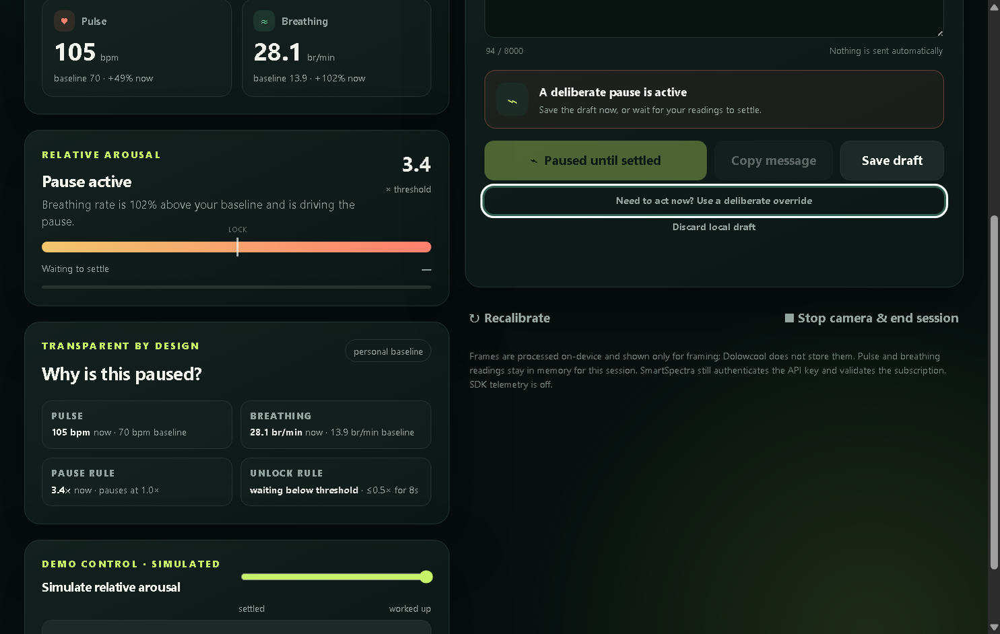

# Dolowcool

**Write now. Send when settled.**

Dolowcool is a privacy-conscious desktop message composer whose email action pauses when camera-estimated pulse or breathing rate rises well above the user's own calm baseline. It unlocks only after a continuous settled hold—or the user can make an explicit, deliberate override.

Built for the [Presage SmartSpectra SDK Challenge](https://dev.to/challenges/presage-2026-11-04).



## Why it is different

- **The live signal controls the core interaction.** Pulse and breathing rate directly determine whether the message action is available.
- **Personal, not population-based.** Dolowcool learns a stable baseline for each session instead of applying a universal “calm” number.
- **Continuous means continuous.** Lost samples reset the calm hold; a signal gap can never silently unlock the action.
- **User agency remains intact.** A clearly disclosed override is available for urgent situations, and nothing is sent automatically.
- **Privacy is the default.** No video or physiological readings are stored, and SmartSpectra telemetry is disabled unless explicitly enabled.

## Experience

1. The user explicitly consents before the camera starts.
2. A live preview and framing guide help establish a clear signal.
3. Dolowcool learns a stable, continuous personal baseline.
4. The user writes while pulse and breathing remain visible.
5. A relative-arousal score uses the stronger rise of pulse or breathing rate.
6. If the score crosses the threshold, email and copy actions pause.
7. The actions return only after readings remain below the lower threshold for eight continuous seconds.
8. The user reviews the message in their default email app; Dolowcool never sends automatically.

## Run with simulated signals

No camera, API key, or trial credits are needed.

```bash
npm install
npm run start:sim
```

Allow the baseline to finish, then move the simulator slider toward **worked up** to activate the pause. Move it back toward **settled** and hold continuously to unlock.

## Run with SmartSpectra

Requirements:

- Node.js 20 or newer
- Windows x64, macOS Apple Silicon, or Linux x64/ARM64
- A SmartSpectra API key

PowerShell:

```powershell
$env:SMARTSPECTRA_API_KEY='your_key'
npm run start:presage
```

Alternatively, copy `.env.example` to `.env`, paste the key after `SMARTSPECTRA_API_KEY=`, and run `npm run start:presage`. The `.env` file is ignored by Git.

macOS/Linux:

```bash
SMARTSPECTRA_API_KEY=your_key npm run start:presage
```

The app follows Presage's official Electron integration: the renderer owns the browser camera stream and preview, while the SDK's main-process bridge handles native measurement. Only `BREATHING_RATE` and `PULSE_RATE` are requested, avoiding unrelated models and trial usage, and the latest measurements feed the lock engine.

## Verification

```bash
npm test
npm run test:smoke
npm run test:presage-smoke
npm audit
```

With a key in `.env`, `npm run test:live` performs one short telemetry-off test of the real Electron camera and SmartSpectra bridge, then stops automatically.

For a valid pulse-and-breathing run, sit far enough from the camera for both your face and upper chest to be visible with soft front lighting. The test records only pass/fail booleans and SDK status codes; it does not save frames, API keys, or physiological values. See [LIVE_TEST_REPORT.md](LIVE_TEST_REPORT.md) for the latest redacted hardware run.

The tests cover:

- stable personal-baseline calibration;
- threshold smoothing and hysteresis;
- continuous calm-hold unlocking;
- prevention of false unlocks after signal loss;
- the Electron consent, simulator, draft, and stop-session flow.

## Architecture

- `renderer/presage-client.js` — official SmartSpectra renderer integration, camera preview, validation feedback, and metric decoding.
- `renderer/lock.js` — pure, tested baseline and state engine.
- `renderer/renderer.js` — experience state, explanations, draft handling, email handoff, and deliberate override.
- `sources/sim.js` — camera-free signal simulator.
- `main.js` — window security, SDK bridge, permission boundary, simulator IPC, and safe `mailto:` handoff.

## Consent and data handling

- Camera access starts only after an unchecked consent box is selected and **Begin a private session** is clicked.
- **Stop camera & end session** releases the camera and discards in-memory readings.
- Dolowcool stores no video and no physiological readings.
- Optional message drafts are stored only in local `localStorage` and can be deleted with **Discard local draft**.
- The API key is loaded from `SMARTSPECTRA_API_KEY`, passed through the context-isolated local Electron renderer to the official SmartSpectra bridge, and is never written to app storage.
- SmartSpectra telemetry is disabled by default with `enableTelemetry: false`. Set `DOLOWCOOL_TELEMETRY=1` to opt in.
- Presage states that enabled telemetry contains device, session, performance, and quality summaries, but not raw frames or physiological values. Authenticated requests may be associated with an account, and diagnostic reports currently have no automatic expiration.
- Dolowcool uses no optional AI service.
- This is a wellness and reflection tool, not a medical device. It does not diagnose emotions, conditions, or health states.

See [SmartSpectra SDK Telemetry & Privacy](https://smartspectra.presagetech.com/docs/telemetry-and-privacy) and the [Presage Privacy Policy](https://api.physiology.presagetech.com/privacypolicy).

## License

MIT — see [LICENSE](LICENSE).
